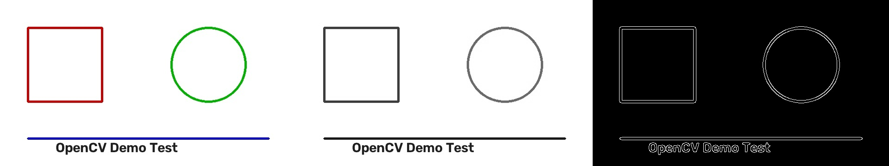
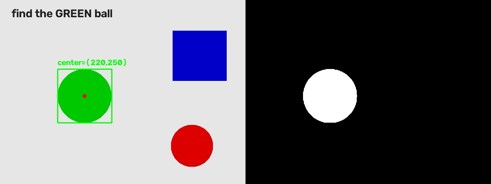
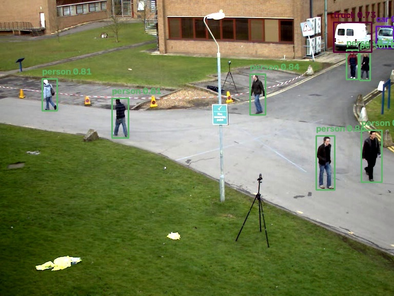
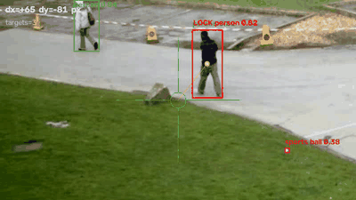
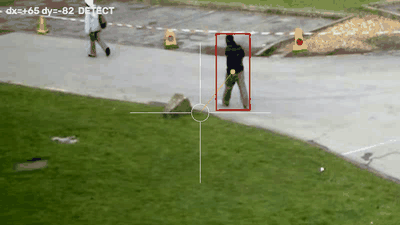

# 视觉学习 Demo 集 · RM 视觉组独立路线

从零跑通的计算机视觉 demo，按「边缘 → 颜色 → 检测 → 自瞄 → 跟踪」递进，另含一个 C++ 同功能对照。
面向 RoboMaster 视觉/算法组的核心能力，也适合作为 CV 方向的作品集第 0 件。

- 作者：王思茹（中山大学 · 人工智能学院 26 级）
- 仓库：https://github.com/Aurora-hut/cv-learning-demos
- 说明：代码由 AI 协作生成，本人在本机实际运行并验收；文中所有数字均为本机实测。

---

## 环境

| 项目 | 版本 / 说明 |
|---|---|
| 系统 | Windows 10 家庭中文版 25H2（Build 26200） |
| Python | 3.13.12（**注意**：本机 `python` 指向 Anaconda 3.7，跑不了；需用完整路径调 3.13.12） |
| OpenCV | 5.0.0.93 |
| numpy | 2.5.4 |
| 模型 | YOLO26n（10 MB，默认，快）/ YOLO26s（38 MB，更准），ONNX，COCO 80 类 |

安装依赖：

```bash
pip install opencv-python numpy
```

模型不进仓库（体积 + 可重新下载），需要时执行：

```bash
mkdir -p models
# 小模型（默认，快）
curl -L -o models/yolo26n.onnx \
  "https://hf-mirror.com/unileon-robotics/YOLO26-ONNX/resolve/main/dynamic/yolo26n.onnx"
# 更大更准的版本（可选）
curl -L -o models/yolo26s.onnx \
  "https://hf-mirror.com/unileon-robotics/YOLO26-ONNX/resolve/main/dynamic/yolo26s.onnx"
```

---

## 四个 demo

| # | 文件 | 做什么 | 关键点 |
|---|---|---|---|
| 1 | `demo1_edge.py` | 灰度化 + Canny 边缘检测 | 输出「原图 \| 灰度 \| 边缘」三连图 |
| 2 | `demo2_color_track.py` | HSV 颜色阈值追踪目标 | 转 HSV 抗光照、取最大轮廓、算中心坐标 |
| 3 | `demo3_detect.py` | YOLO26n 目标检测 | OpenCV DNN 跑 ONNX，不依赖 PyTorch；letterbox + NMS |
| 4 | `demo4_aim.py` | 目标锁定 + 自瞄偏移量 | 选目标打分、算 dx/dy、速度预判补偿延迟 |
| 5 | `demo5_track.py` | 检测 + 光流跟踪分离 | 隔 N 帧检测一次，中间 Lucas-Kanade 光流跟着走，帧率提升约 10 倍 |

运行方式（三种模式通用）：

```bash
python demo4_aim.py --image 图片.jpg     # 图片
python demo4_aim.py --video 视频.mp4     # 视频，输出 demo4_out.mp4
python demo4_aim.py                      # 摄像头实时，按 q 退出
```

Windows 上也可直接双击 `运行demo1.bat` ~ `运行demo5.bat`（内容为纯英文，避免 GBK 乱码）。

---

## 效果

| ① 边缘检测 | ② 颜色追踪 |
|---|---|
|  |  |

| ③ YOLO26s 目标检测 | ④ 目标锁定与偏移量 |
|---|---|
|  |  |

⑤ 检测 + 光流跟踪（绿框＝跟踪中，红框＝刚检测校正，白准星＝画面中心，橙点＝瞄准点）：



---

## demo4 的延迟问题与修法

初版用纯 EMA 平滑，准星会落后目标。在 `demo4_pan.mp4`（60 帧匀速横移）上实测：

| smooth | lead | 平均绝对滞后 | 最大 | 偏置 |
|---|---|---|---|---|
| 0.6 | 0（只平滑） | 10.17 px | 36.82 px | +10.17 |
| 0.6 | 1.0 | 3.69 px | 21.60 px | +3.58 |
| **0.5** | **1.0（默认）** | **1.41 px** | 11.63 px | **+0.20** |
| 0.4 | 0.8 | 1.29 px | 6.62 px | -0.76 |

修法：先用目标速度预判 `lead` 帧位置（`px = tx + v * lead`），再做平滑。
即"平滑负责不抖、预判负责不慢"，两个参数各自可调：

```bash
python demo4_aim.py --video demo4_pan.mp4 --smooth 0.4 --lead 0.8
```

---

## demo5：检测 + 跟踪分离（帧率提升约 10 倍）

每帧都跑神经网络太慢。做法是**隔 N 帧检测一次**做校正，中间用 **Lucas-Kanade 光流**
跟踪目标框内的特征点，取位移中位数来平移框；有效点太少或框出画面就强制重新检测。
这也是 RM 队伍的标准套路（检测几 Hz + 跟踪几十 Hz）。

同一段 80 帧视频（`demo5_clip.mp4`，800×450）实测：

| 方案 | 平均耗时/帧 | 有效帧率 |
|---|---|---|
| 每帧都检测（demo4） | 161 ms | 6.2 FPS |
| 检测每 10 帧 + 光流跟踪（demo5） | 15 ms | **64.6 ~ 68.7 FPS** |

跟踪精度（只在首次检测后纯跟踪、不重检，与理论位移对比）：**40 帧累计偏差 ≤ 2 px**。

```bash
python demo5_track.py --video demo5_clip.mp4          # 绿框=跟踪中，红框=刚检测校正
python demo5_track.py                                  # 摄像头实时，按 q 退出
python demo5_track.py --every 20                        # 检测更稀、更快，但更容易飘
```

> 注意：`--every` 越大越快，但目标形变/遮挡时更容易跟丢。跟丢会自动触发重检。

---

## 为什么"识别不到手机"？（模型能力边界）

`yolo26n` / `yolo26s` 都只在 **COCO 80 类**上训练，边界是硬的：

- 只认这 80 类，超出的物体不会被"创造"出来，只会被硬塞成最像的类，或者直接漏掉
- `cell phone` 是第 67 类，但训练样本多是"手持远处的小手机"。把手机怼到镜头前（占画面很大、
  只露出背面、或屏幕反光一片白）属于**域偏移**，模型大概率认不出
- 置信度低于阈值就被过滤：默认 0.25 会砍掉大量"看到了但不敢确认"的候选

**实测记录**（2026-10-25，本机内置摄像头，`yolo26s` + `--conf 0.05`）：

| 手机朝向 | 结果 |
|---|---|
| 正面（屏幕朝镜头） | `cell phone 0.45` ✅ 稳定检出 |
| 背面（手机壳 + 摄像头模组） | 完全无框 ❌ |

同一个物体、同一台设备、同一套参数，仅换了个朝向就从 0.45 掉到 0。
所以不是亮度或距离的问题，而是**训练样本里几乎没有"手机背面"这种外观**。

排查顺序（从便宜到贵）：

1. **先确认摄像头管线没问题**：举远一点、正常光线，看能否稳定检出 `person`。
   连人都检不到，就是光线/距离/遮挡的问题，不是模型的锅。
2. **降阈值看候选**：`--conf 0.05`。屏幕上能出现框，说明模型有感觉，只是分数低。
3. **换更大模型**：`--model models/yolo26s.onnx`（38 MB）。同一张图上置信度 0.73~0.87，
   且不再出现 n 版 `sports ball` 那种误检。
4. **实在认不出，就只有两条路**：
   ① 用自己的数据微调（要 PyTorch + 数据集，几十 GB 级下载，本机网速不现实）；
   ② **换思路**——神经网络擅长"认语义"（这是什么），传统 CV 擅长"认几何"（这里有个矩形/两条亮线）。
      后者用边缘 + 轮廓 + 最小外接矩形就能框住手机正反两面，
      也正是 RM 装甲板识别的经典做法（找灯条 → 配对 → 几何约束）。

> 降阈值不是免费的：候选框变多、NMS 变慢。同一段视频实测 `conf=0.25` 约 65 FPS，`conf=0.1` 掉到 26 FPS。

诊断命令（摄像头模式，按 `s` 存 `cam_snapshot.jpg`，按 `q` 退出）：

```bash
python demo3_detect.py --conf 0.05 --model models/yolo26s.onnx
```

---

## C++ 版：工具链与「到底快多少」

`cpp/` 里是 `demo1_cpp.cpp`，和 Python 版 demo1 做同一件事（灰度 + Canny，输出三连图），用来打通 C++ 工具链并做语言对照。

### 环境（已装好）

| 项目 | 位置 / 版本 |
|---|---|
| MSYS2 | `D:\msys64`（装在 D 盘，不需要管理员权限） |
| 编译器 | `ucrt64\bin\g++.exe` — GCC **16.2.0** |
| OpenCV | **5.0.0**（`pacman -S mingw-w64-ucrt-x86_64-opencv`） |
| 头文件 / 包名 | `include/opencv5/opencv2/`，pkg-config 包名是 **`opencv5`**（不是 opencv4） |

编译运行：双击 `cpp/build.bat`（内部用 `pkg-config` 自动取编译参数，优先 `opencv5`、回退 `opencv4`）。

### 实测对比（同一张 640×360 图）

| 写法 | 耗时 | 相对 |
|---|---|---|
| Python 调 OpenCV 函数（`cvtColor` + `Canny`） | 3.49 ms/帧 | 基准 |
| C++ 调同样的 OpenCV 函数 | 5.59 ~ 7.97 ms/帧 | 反而略慢 |
| Python 纯 for 循环逐像素统计 | 38.29 ms/帧 | — |
| **C++ 手写逐像素统计** | **0.21 ms/帧** | **约 182 倍** |

**结论（重要，别被"换 C++ 就更快"误导）：**

- 调 OpenCV 函数时，真正干活的是库内部的 C++，跟你用什么语言写调用**无关**。
  这里 C++ 反而慢一点，是因为两套 OpenCV 的构建配置不同——pip 的 wheel 与 MSYS2 的打包优化项不一致，
  实测两者都启用了 TBB + OpenCL、8 线程，属同一量级。
- C++ 真正拉开差距的地方是**你自己写循环**：0.21 ms vs 38.29 ms。
  RM 视觉里大量自定义处理（灯条扫描、二值化、连通域筛选）正是这种活，这才是队伍用 C++ 的原因。

---

## 踩过的坑（OpenCV 5.0 / Windows）

1. **OpenCV 5.0 移除了 Caffe 读取器**，`readNetFromCaffe` 不存在 → 模型只能走 ONNX。
2. **OpenCV 5.0 打不开含中文的绝对路径**的文件 → 先 `os.chdir` 到脚本目录用相对路径；图片读写用 `np.fromfile + imdecode`、`imencode + tofile`。
3. **`.bat` 里不能写中文**：cmd 按 GBK 解码 UTF-8 会把命令拆碎（报 `'?..' 不是内部或外部命令`）→ bat 一律纯英文 + `cd /d "%~dp0"`。
4. **GitHub 直连不通时**，模型可从 `hf-mirror.com` 拉取；`raw.githubusercontent.com` 与 Git LFS 均不可用。
5. **MSYS2 首次装包会卡在 PGP 公钥提示**：`pacman -Sy --noconfirm` 管不到密钥环那一步，表现为"假死"；
   而 `pacman-key --init` 在本机还会陷入 `gpg: lockfile disappeared` 死循环
   → 绕法是把 `etc/pacman.conf` 的 `SigLevel` 临时改为 `Never`（包仍走 HTTPS 清华源）。

---

## 目录

```
.
├── demo1_edge.py          边缘检测
├── demo2_color_track.py   颜色追踪
├── demo3_detect.py        YOLO26n 目标检测
├── demo4_aim.py           目标锁定 + 自瞄偏移（复用 demo3）
├── demo5_track.py         检测 + 光流跟踪分离
├── cpp/                   C++ 版同功能对照
│   ├── demo1_cpp.cpp
│   └── build.bat          一键编译运行（pkg-config 自动取参数）
├── gen_test2.py           生成 demo2 测试图
├── 生成测试图.py           生成 demo1 测试图
├── 运行demo1~5.bat         一键运行（纯英文）
├── models/                模型目录（.onnx 不入库）
├── docs/                  README 用的截图与 GIF
└── *_out.jpg / demo4_out.mp4   各 demo 实测输出
```
