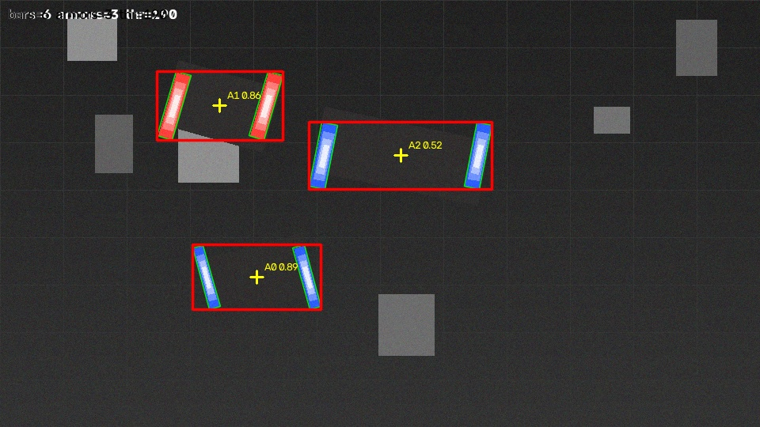
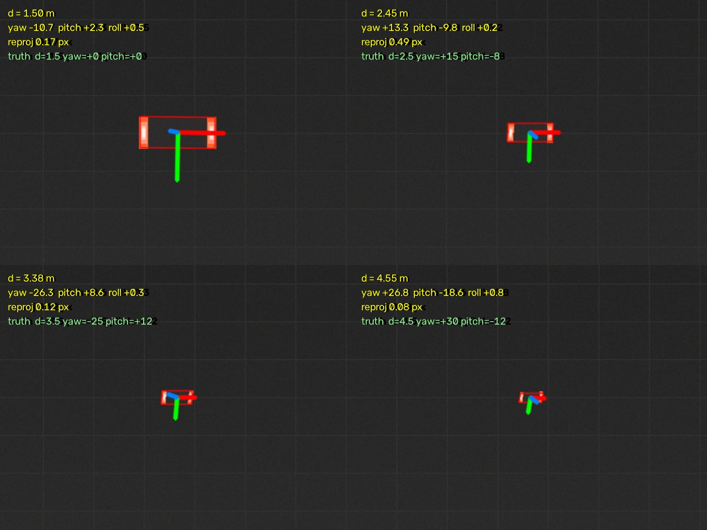
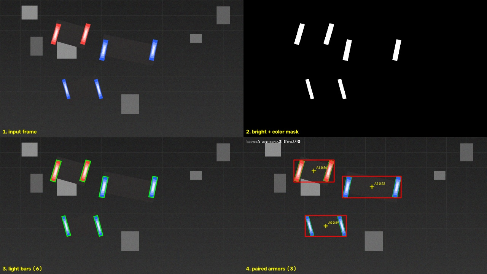

# 视觉学习 Demo 集 · RM 视觉组独立路线

从零跑通的计算机视觉 demo，按「边缘 → 颜色 → 检测 → 自瞄 → 跟踪 → 灯条配对 → PnP 位姿解算」递进，另含相机标定与一个 C++ 同功能对照。
面向 RoboMaster 视觉/算法组的核心能力，也适合作为 CV 方向的作品集第 0 件。

- 作者：王思茹（中山大学 · 人工智能学院 26 级）
- 仓库：https://github.com/Aurora-hut/cv-learning-demos
- 说明：代码由 AI 协作生成，本人在本机实际运行并验收；文中所有数字均为本机实测。

---

## 环境

| 项目 | 版本 / 说明 |
|---|---|
| 系统 | Windows 10 家庭中文版 25H2（Build 26200） |
| Python | 3.13.12（**注意**：本机 `python` 指向 Anaconda 3.7，跑不了；需用完整路径调 3.13.12） |
| OpenCV | 5.0.0.93 |
| numpy | 2.5.4 |
| 模型 | YOLO26n（10 MB，默认，快）/ YOLO26s（38 MB，更准），ONNX，COCO 80 类 |

安装依赖：

```bash
pip install opencv-python numpy
```

模型不进仓库（体积 + 可重新下载），需要时执行：

```bash
mkdir -p models
# 小模型（默认，快）
curl -L -o models/yolo26n.onnx \
  "https://hf-mirror.com/unileon-robotics/YOLO26-ONNX/resolve/main/dynamic/yolo26n.onnx"
# 更大更准的版本（可选）
curl -L -o models/yolo26s.onnx \
  "https://hf-mirror.com/unileon-robotics/YOLO26-ONNX/resolve/main/dynamic/yolo26s.onnx"
```

---

## 七个 demo

| # | 文件 | 做什么 | 关键点 |
|---|---|---|---|
| 1 | `demo1_edge.py` | 灰度化 + Canny 边缘检测 | 输出「原图 \| 灰度 \| 边缘」三连图 |
| 2 | `demo2_color_track.py` | HSV 颜色阈值追踪目标 | 转 HSV 抗光照、取最大轮廓、算中心坐标 |
| 3 | `demo3_detect.py` | YOLO26n 目标检测 | OpenCV DNN 跑 ONNX，不依赖 PyTorch；letterbox + NMS |
| 4 | `demo4_aim.py` | 目标锁定 + 自瞄偏移量 | 选目标打分、算 dx/dy、速度预判补偿延迟 |
| 5 | `demo5_track.py` | 检测 + 光流跟踪分离 | 隔 N 帧检测一次，中间 Lucas-Kanade 光流跟着走，帧率提升约 10 倍 |
| 6 | `demo6_armor.py` | **不用神经网络**，纯几何找灯条并配对成装甲板 | 亮度 + 颜色通道差双掩码、PCA 定倾角、两两配对打分；960×540 下 **12.5 ms/帧** |
| 7 | `demo7_pnp.py` | PnP 解算：距离（米）+ yaw/pitch/roll | 4 点 IPPE、平面双解处理、时序先验；距离误差 **2.0%** |
| — | `calibrate_camera.py` | 张正友标定，给 demo7 提供真实内参 | 棋盘格生成 + 角点亚像素 + 离线自测（fx 误差 0.13%） |

运行方式（三种模式通用）：

```bash
python demo4_aim.py --image 图片.jpg     # 图片
python demo4_aim.py --video 视频.mp4     # 视频，输出 demo4_out.mp4
python demo4_aim.py                      # 摄像头实时，按 q 退出

python demo6_armor.py                    # 合成场景自测（不开摄像头也能看）
python demo6_armor.py --selftest         # 跑 60 个随机场景，打印检出率/误差/耗时

python demo7_pnp.py                      # 合成 3D 场景，解算值和真值对照
python demo7_pnp.py --selftest           # 四段式精度报告
python calibrate_camera.py --make-board   # 先生成标定棋盘格
python calibrate_camera.py               # 拍照标定，得到 camera.json
```

Windows 上也可直接双击 `运行demo1.bat` ~ `运行demo7.bat`（内容为纯英文，避免 GBK 乱码）。

---

## 效果

| ① 边缘检测 | ② 颜色追踪 |
|---|---|
|  |  |

| ③ YOLO26s 目标检测 | ④ 目标锁定与偏移量 |
|---|---|
|  |  |

⑤ 检测 + 光流跟踪（绿框＝跟踪中，红框＝刚检测校正，白准星＝画面中心，橙点＝瞄准点）：


⑥ 灯条配对（红框＝装甲板，绿灯条＝候选灯条，黄十字＝装甲板中心）：



⑦ PnP 位姿解算（红框＝解出的装甲板位置，三色轴＝解出的姿态，文字＝解算值 vs 真值）：



---

## demo4 的延迟问题与修法

初版用纯 EMA 平滑，准星会落后目标。在 `demo4_pan.mp4`（60 帧匀速横移）上实测：

| smooth | lead | 平均绝对滞后 | 最大 | 偏置 |
|---|---|---|---|---|
| 0.6 | 0（只平滑） | 10.17 px | 36.82 px | +10.17 |
| 0.6 | 1.0 | 3.69 px | 21.60 px | +3.58 |
| **0.5** | **1.0（默认）** | **1.41 px** | 11.63 px | **+0.20** |
| 0.4 | 0.8 | 1.29 px | 6.62 px | -0.76 |

修法：先用目标速度预判 `lead` 帧位置（`px = tx + v * lead`），再做平滑。
即"平滑负责不抖、预判负责不慢"，两个参数各自可调：

```bash
python demo4_aim.py --video demo4_pan.mp4 --smooth 0.4 --lead 0.8
```

---

## demo5：检测 + 跟踪分离（帧率提升约 10 倍）

每帧都跑神经网络太慢。做法是**隔 N 帧检测一次**做校正，中间用 **Lucas-Kanade 光流**
跟踪目标框内的特征点，取位移中位数来平移框；有效点太少或框出画面就强制重新检测。
这也是 RM 队伍的标准套路（检测几 Hz + 跟踪几十 Hz）。

同一段 80 帧视频（`demo5_clip.mp4`，800×450）实测：

| 方案 | 平均耗时/帧 | 有效帧率 |
|---|---|---|
| 每帧都检测（demo4） | 161 ms | 6.2 FPS |
| 检测每 10 帧 + 光流跟踪（demo5） | 15 ms | **64.6 ~ 68.7 FPS** |

跟踪精度（只在首次检测后纯跟踪、不重检，与理论位移对比）：**40 帧累计偏差 ≤ 2 px**。

```bash
python demo5_track.py --video demo5_clip.mp4          # 绿框=跟踪中，红框=刚检测校正
python demo5_track.py                                  # 摄像头实时，按 q 退出
python demo5_track.py --every 20                        # 检测更稀、更快，但更容易飘
```

> 注意：`--every` 越大越快，但目标形变/遮挡时更容易跟丢。跟丢会自动触发重检。

---

## 为什么"识别不到手机"？（模型能力边界）

`yolo26n` / `yolo26s` 都只在 **COCO 80 类**上训练，边界是硬的：

- 只认这 80 类，超出的物体不会被"创造"出来，只会被硬塞成最像的类，或者直接漏掉
- `cell phone` 是第 67 类，但训练样本多是"手持远处的小手机"。把手机怼到镜头前（占画面很大、
  只露出背面、或屏幕反光一片白）属于**域偏移**，模型大概率认不出
- 置信度低于阈值就被过滤：默认 0.25 会砍掉大量"看到了但不敢确认"的候选

**实测记录**（2026-10-25，本机内置摄像头，`yolo26s` + `--conf 0.05`）：

| 手机朝向 | 结果 |
|---|---|
| 正面（屏幕朝镜头） | `cell phone 0.45` ✅ 稳定检出 |
| 背面（手机壳 + 摄像头模组） | 完全无框 ❌ |

同一个物体、同一台设备、同一套参数，仅换了个朝向就从 0.45 掉到 0。
所以不是亮度或距离的问题，而是**训练样本里几乎没有"手机背面"这种外观**。

排查顺序（从便宜到贵）：

1. **先确认摄像头管线没问题**：举远一点、正常光线，看能否稳定检出 `person`。
   连人都检不到，就是光线/距离/遮挡的问题，不是模型的锅。
2. **降阈值看候选**：`--conf 0.05`。屏幕上能出现框，说明模型有感觉，只是分数低。
3. **换更大模型**：`--model models/yolo26s.onnx`（38 MB）。同一张图上置信度 0.73~0.87，
   且不再出现 n 版 `sports ball` 那种误检。
4. **实在认不出，就只有两条路**：
   ① 用自己的数据微调（要 PyTorch + 数据集，几十 GB 级下载，本机网速不现实）；
   ② **换思路**——神经网络擅长"认语义"（这是什么），传统 CV 擅长"认几何"（这里有个矩形/两条亮线）。
      后者用边缘 + 轮廓 + 最小外接矩形就能框住手机正反两面，
      也正是 RM 装甲板识别的经典做法（找灯条 → 配对 → 几何约束）。

> 降阈值不是免费的：候选框变多、NMS 变慢。同一段视频实测 `conf=0.25` 约 65 FPS，`conf=0.1` 掉到 26 FPS。

诊断命令（摄像头模式，按 `s` 存 `cam_snapshot.jpg`，按 `q` 退出）：

```bash
python demo3_detect.py --conf 0.05 --model models/yolo26s.onnx
```

---

## demo6：灯条配对——自瞄真正的第一步

RM 赛场上，自瞄的起点不是"用神经网络认出车"，而是**找装甲板上那两条发光竖条**。
灯条的形状特征极其稳定：细长、接近竖直、成对出现、间距约等于灯条高度。
所以只用 20 行 OpenCV 几何，就能在 **12.5 ms/帧** 内把装甲板框出来——比跑 YOLO 快一个数量级。



完整流程（自上而下四步）：

| 步骤 | 做什么 | 关键函数 |
|---|---|---|
| ① 双掩码 | 亮度阈值 + 颜色通道差，两种掩码取并集 | `cv2.threshold`、通道相减 |
| ② 形状筛选 | 每个亮块算长宽比 / 填充率 / 倾角，留下像灯条的 | `cv2.minAreaRect`、`findContours` |
| ③ 两两配对 | 高度相近 + 中心等齐 + 倾角一致 + 间距合理 | 自定义打分 |
| ④ 贪心去重 | 分数高的组合先占位，一个灯条只归一块装甲板 | — |

### 为什么必须加"颜色通道差"

只按灰度阈值做，蓝色灯条会**几乎消失**：BGR(255, 95, 45) 的蓝灯条换算成灰度只有 **137**，
比白墙还暗。灰度阈值能抓到的，仅仅是灯条正中那一小条过曝白芯（宽度不到真实灯条的 1/3）。

于是改成两条路一起走：

```python
blue = (B - max(G, R)) > 45      # 蓝灯条：蓝通道远高于其它两通道
red  = (R - max(B, G)) > 45      # 红灯条就反过来
mask = (gray > thr) | blue | red
```

场地背景几乎不会这么"纯"，所以这个判据既找得全、又比亮度更抗干扰。
**加上通道差之后，同一个场景的检出率从 71.4% 提到 100%。**

### 实测数据

60 个随机合成场景、125 块装甲板（灯条长度 46–120 px、倾角 ±26°、带 4–10 个亮块干扰）：

| 指标 | 结果 |
|---|---|
| 检出率 | **100%（125/125）** |
| 中心误差 | 中位数 **0.74 px**，p90 **0.96 px** |
| 误检 | **0 个**多余框 |
| 单帧耗时 | 960×540 **12.5 ms**（80 FPS）；640×360 **6.4 ms**（155 FPS）；1280×720 **18.2 ms**（55 FPS） |

对比 demo3 的 YOLO26n 在 CPU 上只有约 **6.2 FPS**——纯几何路线快 9~25 倍，
这也是 RM 队伍普遍采用"传统视觉打灯条、神经网络兜底"的原因。

### 三个把算法坑掉的 bug（记录一下，都是我自己写的）

1. **合成图的灯条越画越暗**：一开始用 `addWeighted` 层层叠加，第二条灯条继承了第一条的衰减，
   第三条只亮到 1/3——测出来的"漏检"其实是数据 bug。改成"一层层盖不透明色"才对齐。
2. **`minAreaRect` 的角度约定靠不住**：它返回的 `angle` 在 OpenCV 4.3 / 4.5 / 5.0 之间改过多次定义，
   用 `boxPoints` 反推长边方向也会被 w/h 先后顺序坑到（-90° 时直接翻车，一条灯条被判成"水平"而丢弃）。
   最终改用**轮廓点云的 PCA 主轴**定方向——只跟形状有关，换版本也不变。
3. **"第一个能出结果的阈值就收手"是错的**：高阈值常常只能捞到一半灯条，正好配出一块装甲板就返回了，
   另一块暗一点的整块丢掉。改成**所有阈值都试、按"装甲板数 − 未配对灯泡数"取最优**，
   并加一条快速通道：如果灯条基本都成对了就提前 break。

### 已知局限

- 两块装甲板**在画面上物理重叠**时，两条灯条会粘成一个轮廓（填充率掉到 0.4 以下）而被丢弃。
  真实比赛里两车交叠也会这样，正规做法是上分水岭或直接交给神经网络兜底。
- 纯白光源（白灯条、白墙、日光灯管）会被亮度掩码抓进来，靠形状筛选挡掉大部分，但画面里白灯管多时需要调高 `--thr`。
- 只做 2D 检测，没有 PnP 解算，所以拿不到距离和姿态——那是 demo7 的事。

---

## demo7：PnP 解算——从「在哪」到「多远、偏多少度」

demo6 只告诉我装甲板在图像上的**像素位置**。要打中它，真正需要的是相机坐标系里的**距离（米）**和**姿态角（yaw / pitch / roll）**。

PnP（Perspective-n-Point）解的就是这个反问题：

```
s · [u, v, 1]ᵀ = K · (R · P_world + t)
```

已知三样东西就能解出 `R` 和 `t`：物体坐标系下 4 个点的三维坐标、它们在图像上的像素坐标、相机内参 `K`。

**为什么必须要"已知尺寸的刚体"**：单个点的投影会丢掉深度信息 `s`，只靠 2D 永远恢复不出 3D。
装甲板恰好是标准件（外框 135 mm × 55 mm），它的物理尺寸提供了唯一的尺度约束——这也是为什么"没标定过尺寸的目标，PnP 解不出真实距离"。


### 实测（1280×720，fx≈1005，仿真检测噪声 0.6 px，60 组随机位姿）

**① 零噪声基线**——先证明算法本身没有误差：

| 真值 | yaw 误差 | pitch 误差 | 距离误差 |
|---|---|---|---|
| d=3.0m yaw=0° pitch=0° | 0.00e+00° | 0.00e+00° | 1.8e-12 mm |
| d=3.0m yaw=+20° pitch=0° | 1.1e-13° | 8.3e-19° | 3.1e-12 mm |
| d=2.0m yaw=+35° pitch=-20° roll=-10° | 7.8e-14° | 8.2e-14° | 4.4e-13 mm |

全部是浮点零。说明**角点顺序、欧拉角约定、solvePnP 的调用全对**，下面所有误差都来自像素噪声，不是代码写错了。
（这一条很重要：调 PnP 最常见的失败是角点顺序错，而它不会报错，只会"莫名其妙打偏"。）

**② 有噪声时的实际精度**：

| 距离区间 | 距离相对误差 | 距离绝对误差 | yaw 误差 | pitch 误差 |
|---|---|---|---|---|
| 1.5–2.5 m | 1.71% | 34 mm | 3.27° | 2.16° |
| 2.5–3.5 m | 1.35% | 44 mm | 7.21° | 7.22° |
| 3.5–5.1 m | 2.64% | 115 mm | 5.21° | 6.64° |
| **总体** | **2.02%** | **61 mm** | **4.91°** | **4.49°** |

单次解算 **0.5 ms**，重投影误差 0.34 px（≈ 检测噪声本身，说明解算没引入额外损失）。

**③ 噪声敏感度**——这张表解释了"为什么远处就打不准"：

| 检测噪声 | yaw 误差 | pitch 误差 | 距离误差 |
|---|---|---|---|
| 0.0 px | 0.00° | 0.00° | 0 mm |
| 0.2 px | 1.96° | 1.96° | 19 mm |
| 0.5 px | 6.12° | 6.55° | 49 mm |
| 1.0 px | 12.92° | 10.21° | 88 mm |
| 2.0 px | 18.72° | 15.88° | 164 mm |

角度误差几乎与像素噪声**成正比**。想稳住角度只有两条路：降噪声（更好的灯条分割）、拉长焦距（同距离下目标像素更多）。没有第三条。

### 平面双解歧义：这个 demo 最该记住的一件事

同一次检测，`solvePnPGeneric` 会返回**两个解**：

| | yaw | pitch | 距离 | 重投影误差 |
|---|---|---|---|---|
| 解 0 | -13.35° | -15.00° | 3.04 m | 0.2934 px |
| 解 1 | +13.47° | +15.01° | 3.04 m | 0.3565 px |

重投影误差只差 **0.063 px**，但姿态差了 **26.8°**。这不是 bug——平面目标在透视下天生有两个镜像解，单帧无法区分。

我实测过"多帧取平均能不能救"，答案是**不能**：

| 帧数 | 1 | 2 | 4 | 8 | 16 | 32 |
|---|---|---|---|---|---|---|
| yaw 误差 | 11.9° | 14.4° | 11.8° | 13.2° | 14.2° | 12.7° |

一帧都不降。因为每帧都在两个镜像解之间跳，平均出来正好是中间那个错误值。

**正确做法是时序先验**：用上一帧的姿态在后选解（`solve_pose(..., prev_rvec=...)`），而不是平均。
demo7 的摄像头/视频模式就是这么做的——第一帧可能选错，之后靠"这一帧不该突然翻 30°"这个先验锁住。

### 相机标定：不做这一步，距离就是错的

PnP 用的是 `K`。如果 `K` 是猜的，解出来的距离会**整体乘上一个错误系数**——形状和姿态大致对，但"3 米"可能实际是 "3.6 米"。打靶要绝对距离，所以这一步绕不过去。

```bash
python calibrate_camera.py --make-board   # 生成 9x6 / 25mm 棋盘格（约 274x209mm，A4 放得下）
python calibrate_camera.py                # 举着棋盘格摆 15+ 个姿势，空格拍照
python demo7_pnp.py --calib camera.json   # 用标定结果跑
```

标定流程本身做了离线验证（`--selftest`）：

| 参数 | 真值 | 标定值 | 误差 |
|---|---|---|---|
| fx | 1000.00 | 1001.30 | 0.13% |
| fy | 1005.00 | 1006.08 | 0.11% |
| cx | 646.00 | 644.99 | 1.01 px |
| cy | 356.00 | 354.23 | 1.77 px |

### 踩过的坑（都是端到端一测才暴露的）

1. **demo6 的隐藏 bug：`if len(pts) < 5: continue`**。`CHAIN_APPROX_SIMPLE` 会把一个远处小灯条的轮廓直接压成 **4 个角点**，于是整类小目标被悄悄丢掉。改成 `< 4` 之后，端到端才连得通。图形算法的"看起来没问题"最危险。
2. **别用 640×480 测 PnP**。3 m 外 135 mm 的装甲板在 640×480 只有 25 px 宽，0.5 px 噪声就能让角度飘十几度——那是分辨率极限，不是算法问题。真实 RM 相机是 1280×1024 起步、fx≈1000 的量级。
3. **OpenCV 5 的 `calibrateCamera` 要求 `Point3f`**，`objectPoints` 给 float64 会直接抛 `should contain vector of vectors of points of type Point3f`。
4. **棋盘格内角点 9×6 就要画 10×7 个方格**。画成 9×6 个方格的话内角点只有 8×5，`findChessboardCorners` 永远返回 false。
5. **`color_masks` 用 numpy 做 int16 相减，单这一步吃掉 18 ms**（整个 detect 才 25 ms）。换成 `cv2.subtract` 饱和相减 + `cv2.max`，全走 C 实现后降到 6 ms。

### 已知局限

- 单帧、正对、小目标时角度本质上不可解（见"双解歧义"），必须靠时序。
- 没有做卡尔曼滤波/目标跟踪，多目标时只跟随第一个。
- 装甲板尺寸写死为小装甲板 135 mm。打大装甲板要改 `ARMOR_W`（230 mm）。

---

## C++ 版：工具链与「到底快多少」

`cpp/` 里是 `demo1_cpp.cpp`，和 Python 版 demo1 做同一件事（灰度 + Canny，输出三连图），用来打通 C++ 工具链并做语言对照。

### 环境（已装好）

| 项目 | 位置 / 版本 |
|---|---|
| MSYS2 | `D:\msys64`（装在 D 盘，不需要管理员权限） |
| 编译器 | `ucrt64\bin\g++.exe` — GCC **16.2.0** |
| OpenCV | **5.0.0**（`pacman -S mingw-w64-ucrt-x86_64-opencv`） |
| 头文件 / 包名 | `include/opencv5/opencv2/`，pkg-config 包名是 **`opencv5`**（不是 opencv4） |

编译运行：双击 `cpp/build.bat`（内部用 `pkg-config` 自动取编译参数，优先 `opencv5`、回退 `opencv4`）。

### 实测对比（同一张 640×360 图）

| 写法 | 耗时 | 相对 |
|---|---|---|
| Python 调 OpenCV 函数（`cvtColor` + `Canny`） | 3.49 ms/帧 | 基准 |
| C++ 调同样的 OpenCV 函数 | 5.59 ~ 7.97 ms/帧 | 反而略慢 |
| Python 纯 for 循环逐像素统计 | 38.29 ms/帧 | — |
| **C++ 手写逐像素统计** | **0.21 ms/帧** | **约 182 倍** |

**结论（重要，别被"换 C++ 就更快"误导）：**

- 调 OpenCV 函数时，真正干活的是库内部的 C++，跟你用什么语言写调用**无关**。
  这里 C++ 反而慢一点，是因为两套 OpenCV 的构建配置不同——pip 的 wheel 与 MSYS2 的打包优化项不一致，
  实测两者都启用了 TBB + OpenCL、8 线程，属同一量级。
- C++ 真正拉开差距的地方是**你自己写循环**：0.21 ms vs 38.29 ms。
  RM 视觉里大量自定义处理（灯条扫描、二值化、连通域筛选）正是这种活，这才是队伍用 C++ 的原因。

---

## 踩过的坑（OpenCV 5.0 / Windows）

1. **OpenCV 5.0 移除了 Caffe 读取器**，`readNetFromCaffe` 不存在 → 模型只能走 ONNX。
2. **OpenCV 5.0 打不开含中文的绝对路径**的文件 → 先 `os.chdir` 到脚本目录用相对路径；图片读写用 `np.fromfile + imdecode`、`imencode + tofile`。
3. **`.bat` 里不能写中文**：cmd 按 GBK 解码 UTF-8 会把命令拆碎（报 `'?..' 不是内部或外部命令`）→ bat 一律纯英文 + `cd /d "%~dp0"`。
4. **GitHub 直连不通时**，模型可从 `hf-mirror.com` 拉取；`raw.githubusercontent.com` 与 Git LFS 均不可用。
5. **MSYS2 首次装包会卡在 PGP 公钥提示**：`pacman -Sy --noconfirm` 管不到密钥环那一步，表现为"假死"；
   而 `pacman-key --init` 在本机还会陷入 `gpg: lockfile disappeared` 死循环
   → 绕法是把 `etc/pacman.conf` 的 `SigLevel` 临时改为 `Never`（包仍走 HTTPS 清华源）。

---

## 目录

```
.
├── demo1_edge.py          边缘检测
├── demo2_color_track.py   颜色追踪
├── demo3_detect.py        YOLO26n 目标检测
├── demo4_aim.py           目标锁定 + 自瞄偏移（复用 demo3）
├── demo5_track.py         检测 + 光流跟踪分离
├── demo6_armor.py         灯条配对（纯 OpenCV，无模型）
├── demo7_pnp.py           PnP 位姿解算（距离 + 姿态角）
├── calibrate_camera.py    相机标定（张正友法）
├── cpp/                   C++ 版同功能对照
│   ├── demo1_cpp.cpp
│   └── build.bat          一键编译运行（pkg-config 自动取参数）
├── gen_test2.py           生成 demo2 测试图
├── 生成测试图.py           生成 demo1 测试图
├── 运行demo1~7.bat         一键运行（纯英文）
├── models/                模型目录（.onnx 不入库）
├── docs/                  README 用的截图与 GIF
└── *_out.jpg / demo4_out.mp4   各 demo 实测输出
```
